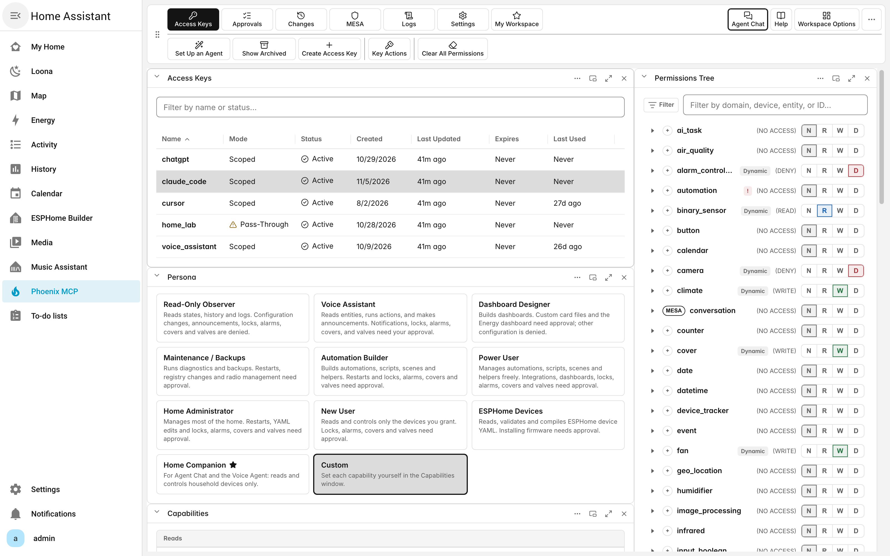
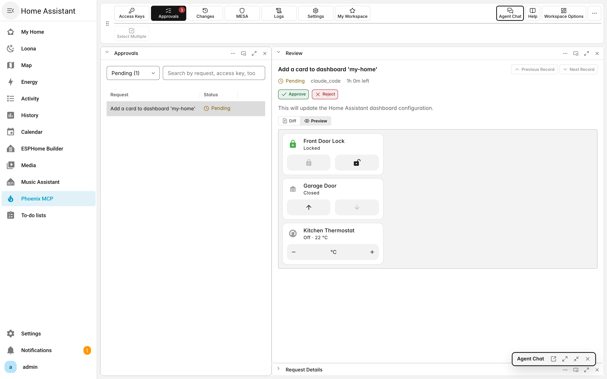
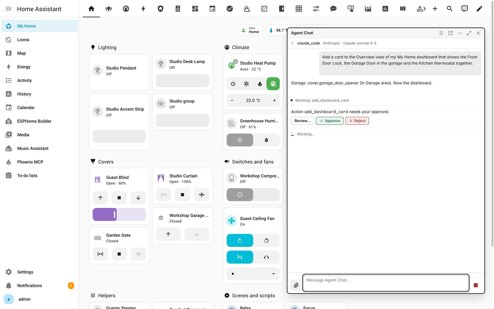
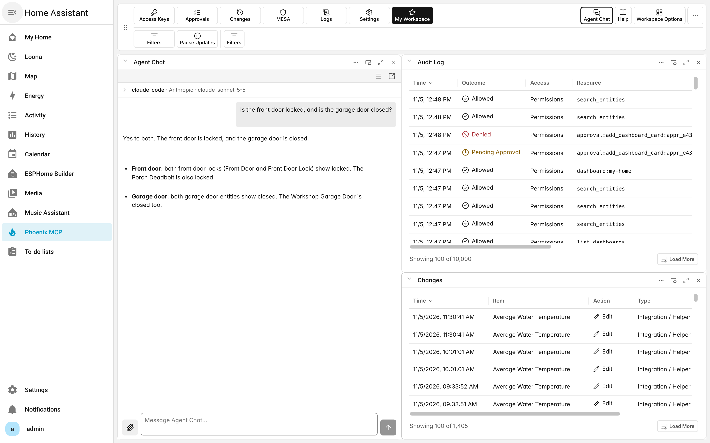

# Phoenix MCP

[English](README.md) | [Español](README.es.md) | [Français](README.fr.md) | [Italiano](README.it.md) | [Deutsch](README.de.md) | [Nederlands](README.nl.md) | [Polski](README.pl.md) | [简体中文](README.zh-CN.md) | [繁體中文](README.zh-Hant.md) | [日本語](README.ja.md) | [한국어](README.ko.md) | [Русский](README.ru.md) | [Svenska](README.sv.md) | [Dansk](README.da.md) | [Norsk Bokmål](README.nb.md) | **Suomi**

Phoenix MCP antaa AI-agenteillesi turvallisen ja rajatun pääsyn Home Assistant -järjestelmään MCP:n (Model Context Protocol) kautta. Se on avoin standardi, joka yhdistää AI-sovellukset työkaluihin ja tietoihin. Turvallisuus on ratkaisevan tärkeää AI:ta käytettäessä, ja Phoenix MCP on käynyt läpi monta kuukautta kehitystä ja toistuvia tietoturvatarkastuksia. Jokaisella agentilla on oma käyttöavaimensa, joka on rajattu vain sallimiisi entiteetteihin ja ominaisuuksiin. Lisäturvakerros (MESA) voi vaatia vahvistuksesi valitulle entiteetille tai sulkea sen kokonaan pois käytöstä riippumatta siitä, mitä oikeuksia käyttöavaimelle on annettu.

Phoenix MCP toimii kokonaan Home Assistant -järjestelmän sisällä, eikä erillistä palvelua tarvitse ottaa käyttöön. Käytä sovelluksia, jotka sinulla jo on, kuten Claude Code, Cursor, ChatGPT tai Gemini, tai keskustele suoraan Home Assistant -järjestelmässä valitsemasi AI-palveluntarjoajan kanssa pilvessä tai paikallisesti Ollama-palvelun kautta.

Opastettu käyttöönotto vie sinut asennuksesta toimivaan agenttiin muutamassa minuutissa, ja tukena on 174 työkalun valikoima kokoonpanosi lukemiseen, ohjaamiseen ja laatimiseen. Phoenix MCP käyttää tuttua ja mukautettavaa ikkunoihin perustuvaa käyttöliittymää, joten alkuun pääsee helposti. Täydellinen dokumentaatio on sisäänrakennettu ja aina käytettävissä.

## Kuvakaappaukset

**Käyttöavaimet**-kohdassa jokaisella agentilla on oma avaimensa. Valitse **Persona** ja päätä sitten **Käyttöoikeuspuu**-ikkunassa, mihin agentti pääsee, aina yksittäiseen entiteettiin asti.

**Hyväksynnät**-kohdassa esikatselet kojelaudan kortin ennen sen lisäämistä. Tässä agentti pyysi lisäämään kortin, eikä mikään muutu ennen kuin valitset **Hyväksy**.

**Agent Chat** on käytettävissä kaikkialla Home Assistant -järjestelmässä. Tässä se luo kortin ja odottaa sitten hyväksyntääsi ennen kuin muuttaa mitään.

**Oma työtila** kokoaa eniten käyttämäsi ikkunat. Tässä **Agent Chat** on **Tarkastusloki**- ja **Muutokset**-ikkunoiden vieressä.

## Kielet

Paneeli tukee tällä hetkellä englantia, espanjaa, ranskaa, italiaa, saksaa, hollantia, puolaa, venäjää, yksinkertaistettua kiinaa, perinteistä kiinaa, koreaa, japania, ruotsia, tanskaa, norjaa ja suomea. Voit vaihtaa paneelin kielen manuaalisesti avaamalla **Phoenix MCP > Asetukset > Kieli** ja valitsemalla kielen. Valitse **Auto**, jos haluat jälleen seurata Home Assistant -profiilisi kieltä.

## Dokumentaatio

Käyttöohje on rakennettu paneeliin: avaa **Phoenix MCP** -paneeli ja valitse **Ohje**-valikosta **Opas**. Se selittää jokaisen ikkunan ja asetuksen, mitä agentit voivat tehdä, käyttöoikeudet, ominaisuudet, MESA:n ja tietoturvan. Se seuraa valintojasi, ja voit hakea siitä.

Ensimmäinen kertasi täällä? Avaa alla olevan käyttöönoton jälkeen **Phoenix MCP** -paneeli ja valitse **Määritä agentti**. Ohjattu toiminto opastaa sinua luomaan käyttöavaimen, valitsemaan, mitä se saa tehdä, ja yhdistämään Agent Chatin tai oman sovelluksesi.

## Vaatimukset

- Home Assistant 2026.7.0 tai uudempi.
- Yksi Phoenix MCP -instanssi jokaista Home Assistant -asennusta kohden. Home Assistant asentaa riippuvuudet `Babel>=2.18.0` ja `jsonschema>=4.26.0` puolestasi.

## Asennus Markkinapaikasta

Home Assistant 2026.11:ssä tai uudemmassa:

1. Avaa **Asetukset > Markkinapaikka** ja valitse **Lisää linkistä**.
2. Syötä `https://github.com/leecaochang/Phoenix-MCP` ja valitse **Lisää**. Ensimmäisellä kerralla Markkinapaikka pyytää yhdistämään GitHubiin.
3. Avaa Phoenix MCP ja valitse **Asenna**. Käynnistä Home Assistant uudelleen vain, jos sitä pyydetään.

Kun päivität HACS:stä, Phoenix MCP siirtyy Markkinapaikkaan itsestään. Yhdistä siellä GitHubiin, jotta saat päivitykset jatkossakin.

## Asennus HACS:n kautta

Home Assistant 2026.10:ssä tai vanhemmassa:

1. Avaa HACS -sovelluksessa oikean yläkulman valikko ja valitse **Mukautetut tietovarastot**.
2. Anna `https://github.com/leecaochang/Phoenix-MCP` ja valitse kategoriaksi **Integraatio**, napsauta sitten **Lisää**.
3. Etsi Phoenix MCP HACS -sovelluksen integraatioluettelosta, asenna se ja käynnistä Home Assistant uudelleen.

Haluatko asentaa käsin? Kopioi `custom_components/phoenix_mcp`-kansio Home Assistant -konfiguraatiohakemistoosi `custom_components/phoenix_mcp`-polun alle ja käynnistä sitten uudelleen.

## Käyttöönotto

Siirry kohtaan **Asetukset > Laitteet ja palvelut > Lisää integraatio** ja etsi **Phoenix MCP**. Viimeistele yksivaiheinen käyttöönotto, avaa sitten **Phoenix MCP** -paneeli sivupalkista ja valitse **Määritä agentti**.

## Ongelmat ja palaute

Ilmoita ongelmista osoitteessa [github.com/leecaochang/Phoenix-MCP/issues](https://github.com/leecaochang/Phoenix-MCP/issues).
